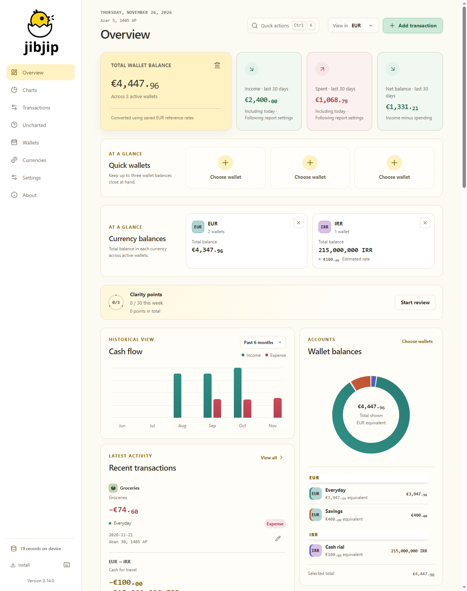
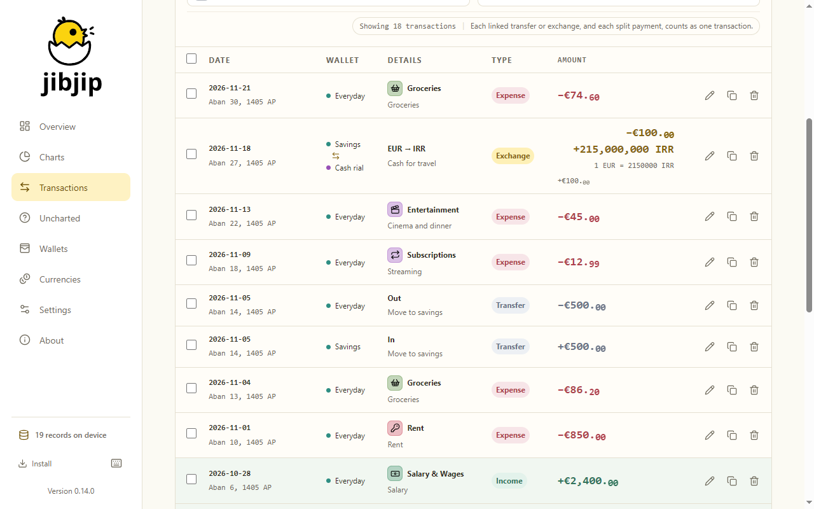
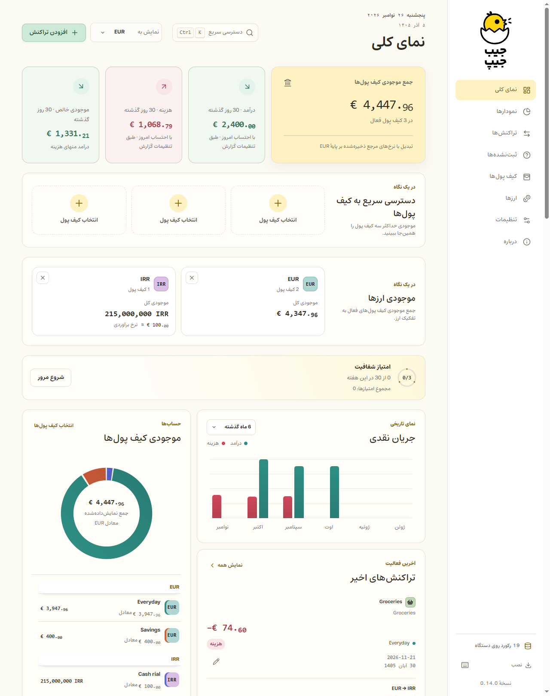

# JIBJIP

JIBJIP (جیب جیپ) is a local-first personal-finance app for income, spending, wallets,
transfers, currency exchange, split payments, reports, and backups. It speaks English
and Persian, shows secondary Jalali dates, and keeps your records in your own browser.
No account is needed.

**Use it at [jibjip.com](https://jibjip.com)**, or install it from there as an app that
also works offline.

- **Wallets in any currency.** 38 built-in currencies with dated exchange-rate history.
  Iranian rial amounts can be shown as rial or toman.
- **Every kind of money movement.** Income, expenses, transfers between wallets,
  currency exchanges, and split payments, with categories and notes.
- **Reports.** Balances, 30-day totals, net worth, and charts in the currency you choose.
- **Backups you control.** A Full backup (`.json.gz`) restores everything; transaction
  CSV moves records in and out of other apps.
- **Offline and installable.** After the first visit the app runs without internet;
  updates download in the background and apply once every JIBJIP window is closed.
- **Clarity.** An optional weekly self-review that stays on your device and never
  touches your money records.

## Screenshots

**Overview.** Balances across wallets and currencies, 30-day totals, and charts.



**Transactions.** Income, spending, transfers, and currency exchanges in one list.



**Persian.** The full interface is also available in Persian, right to left.



All screenshots use made-up data.

## Privacy and data

- Records live in your browser's storage for the site's exact address. Another browser,
  profile, device, or address has its own separate data, and clearing site data deletes
  it, so export Full backups from **Settings**.
- The app sends no records anywhere. Its only network requests fetch exchange rates and
  app updates. There is no account, sync, or tracking in the app.
- The jibjip.com homepage counts visits with Cloudflare Web Analytics, without cookies.
  Copies hosted elsewhere send nothing.

## Run it yourself

You need Node.js 22.13 or later and npm. Python 3 is used by the documentation check
and by the Windows launcher's small local server.

```sh
npm ci
npm run dev     # http://localhost:3000/ with its own empty database
npm run check   # lint, types, tests, and the public build checks
```

On Windows, after `npm ci`, double-click **Open jibjip.cmd**. It builds the app when the
source changes and opens it at `http://localhost:4318/app/`. The introduction at `/`
never touches financial storage; `/app/` opens the application.

To build and check the website files:

```sh
npm run build:public
npm run verify:public
python -m http.server 4320 --bind 127.0.0.1 --directory work/public-candidate
```

[docs/OFFLINE.md](docs/OFFLINE.md) explains installation, offline use, and safe updates.

## Project layout

| Path | Purpose |
| --- | --- |
| [packages/core](packages/core/README.md) | The complete app and its mounting interface |
| `apps/web/` | Thin browser shell with development, personal, and website profiles |
| [docs/PRODUCT_RULES.md](docs/PRODUCT_RULES.md) | Interface, finance, setup, Clarity, backup, and CSV rules |
| [docs/ARCHITECTURE.md](docs/ARCHITECTURE.md) | Source layout, runtime and data boundaries |
| [docs/ROADMAP.md](docs/ROADMAP.md) | Direction and release readiness |
| [docs/VERSIONING.md](docs/VERSIONING.md), [docs/RELEASING.md](docs/RELEASING.md) | Versions and releases |
| [docs/BUGS.md](docs/BUGS.md) | Known defects |
| `scripts/`, `tests/` | Build and release tools, and synthetic tests |

## Contributing

Bug reports and suggestions are welcome as
[GitHub issues](https://github.com/thejaz/jibjip/issues). See
[CONTRIBUTING.md](CONTRIBUTING.md) for development and pull requests. Use made-up data,
never your real records.

## License and credits

JIBJIP is [MIT licensed](LICENSE) and created by [THEJAZ](https://github.com/thejaz). The
JIBJIP name, logo, and sound are not covered by the MIT License; see
[TRADEMARKS.md](TRADEMARKS.md).

- The [Estedad](https://github.com/aminabedi68/Estedad) font is used under the SIL Open
  Font License (`packages/core/assets/fonts/Estedad-OFL.txt`).
- Exchange rates come from [Frankfurter](https://frankfurter.dev/),
  [CoinGecko](https://www.coingecko.com/), [TGJU](https://www.tgju.org/), and the
  [Euro-Rial-Toman dataset](https://github.com/kooroshkz/Euro-Rial-Toman-Live-Price-Dataset)
  by kooroshkz. JIBJIP is not affiliated with these services.
